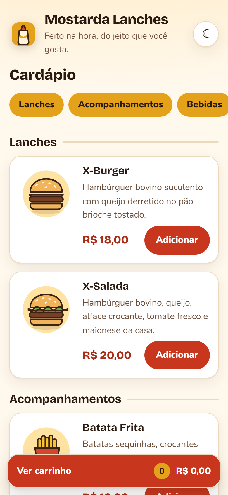
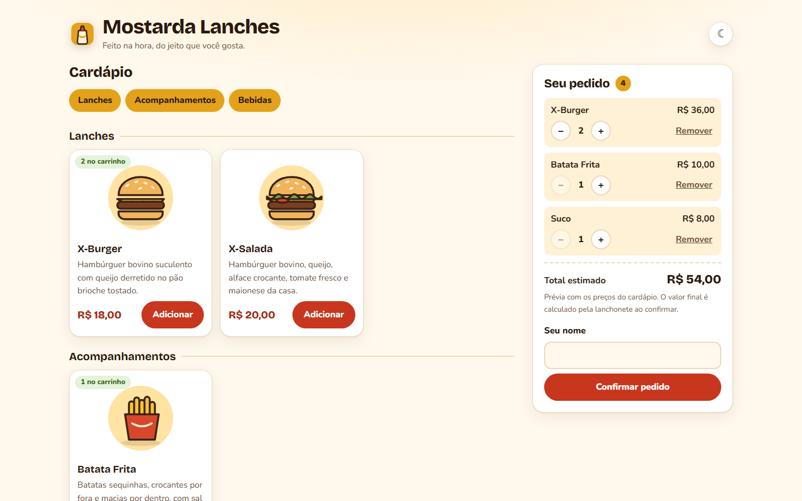
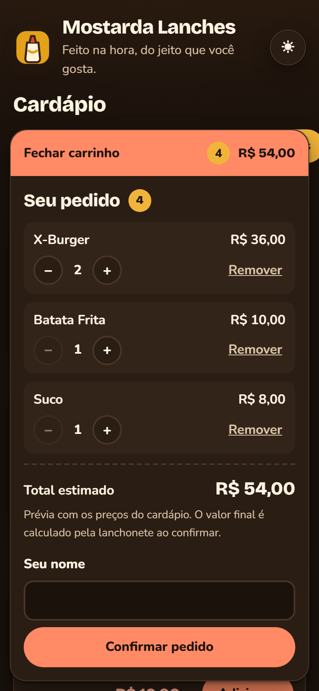
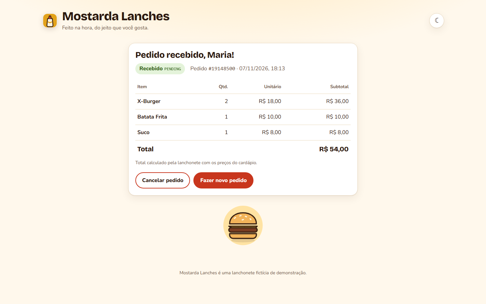

Nível escolhido: B

# Orders API

[](https://github.com/Aquno/GeraTech/actions/workflows/ci.yml)

Repositório: https://github.com/Aquno/GeraTech

API de pedidos de uma lanchonete com cardápio fixo. Cria, consulta, lista e cancela pedidos. O preço de cada item vem sempre do cardápio do servidor, e todos os valores são em centavos inteiros. O foco é engenharia: contrato OpenAPI primeiro, camadas com Repository Pattern, testes com coverage, CI, observabilidade e medição de desempenho contra um SLO.

**Stack:** Node 26 (LTS) · TypeScript (strict) · Fastify 5 · PostgreSQL 16 · Knex · Vitest · pino + prom-client · k6 · Docker Compose · GitHub Actions.

**Interface web** ([`web/`](web/)): React 19 · Vite · TypeScript (strict) · Vitest + Testing Library, servida por nginx sem root.

## Como subir

Pré-requisito: **Docker** com Docker Compose.

```bash
docker compose up --build
```

Esse comando sobe o PostgreSQL, a API (que roda as migrations e o seed do cardápio) e a interface web. Cada serviço só inicia depois que o anterior passa no healthcheck.

| Serviço | Endereço |
|---|---|
| **Interface web (cardápio)** | **http://localhost:8080** |
| API | http://localhost:3000 |
| PostgreSQL | `localhost:5432` |

A interface chama a API pelo próprio nginx, em `/api/` (ex.: `http://localhost:8080/api/products`). O navegador fala sempre com a mesma origem, sem CORS. Para usar outra porta na interface, defina `WEB_PORT`.

**Não é preciso criar `.env`.** O `docker-compose.yml` já traz valores padrão de desenvolvimento (fictícios) no formato `${VAR:-padrão}`. Para mudar algum valor, crie um `.env` local a partir do `.env.example`. O `.env` é ignorado pelo git.

> Se o build falhar com `UNABLE_TO_VERIFY_LEAF_SIGNATURE`, veja [Problemas conhecidos](#problemas-conhecidos).

## Como testar o fluxo

**Pela interface:** abra http://localhost:8080, adicione itens do cardápio, informe o nome e confirme. A tela de confirmação mostra o pedido como a API devolveu (total oficial e status) e permite cancelar. O total do carrinho é só uma prévia.

| Celular | Desktop |
|---|---|
|  |  |
|  |  |

**Pela API:** a documentação interativa (Swagger UI) fica em **http://localhost:3000/docs**.

**Cardápio** (fixo, populado por seed):

| `productId` | Produto | Preço |
|---|---|---|
| `x-burger` | X-Burger | 1800 (R$ 18,00) |
| `x-salada` | X-Salada | 2000 (R$ 20,00) |
| `batata-frita` | Batata Frita | 1000 (R$ 10,00) |
| `refrigerante` | Refrigerante | 600 (R$ 6,00) |
| `suco` | Suco | 800 (R$ 8,00) |

**Criar um pedido.** Só `productId` e `quantity` (1 a 20); o servidor calcula preços e total:

```bash
curl -s -X POST http://localhost:3000/orders \
  -H 'content-type: application/json' \
  -d '{"customerName":"Maria","items":[{"productId":"x-burger","quantity":2},{"productId":"refrigerante","quantity":1}]}'
```

Resposta `201`, com `totalCents` igual a 4200 e status `PENDING`. Guarde o `id` da resposta:

```bash
ID=<id-da-resposta>
```

**Consultar:**

```bash
curl -s http://localhost:3000/orders/$ID
```

**Listar** (do mais recente para o mais antigo):

```bash
curl -s http://localhost:3000/orders
```

**Cancelar.** A primeira chamada responde `200` com status `CANCELLED`; repetir responde `409`:

```bash
curl -s -X POST http://localhost:3000/orders/$ID/cancel
```

Outros erros do contrato:
- produto fora do cardápio: `422`;
- formato inválido ou produto repetido no mesmo pedido: `400`;
- pedido inexistente: `404`.

Todos os erros usam o formato `{ statusCode, error, message, details? }`.

## Endpoints

| Método | Rota | Descrição |
|---|---|---|
| `POST` | `/orders` | Cria um pedido (201; 400 formato ou duplicado; 422 produto inexistente) |
| `GET` | `/orders` | Lista todos os pedidos, do mais recente ao mais antigo (sem paginação, ver riscos) |
| `GET` | `/orders/:id` | Consulta um pedido (200; 400 id inválido; 404) |
| `POST` | `/orders/:id/cancel` | Cancela um pedido `PENDING` (200; 404; 409 se já cancelado) |
| `GET` | `/products` | Cardápio: id, nome, descrição, categoria e preço, ordenado por categoria e nome |
| `GET` | `/health` | Saúde da API e do banco (`200` ok, `503` banco fora) |
| `GET` | `/metrics` | Métricas no formato Prometheus (histograma de latência e métricas do processo) |
| `GET` | `/docs` | Swagger UI gerado a partir do [`docs/openapi.yaml`](docs/openapi.yaml) |

As rotas acima são da API (porta 3000). Pela interface web (porta 8080), as mesmas rotas ficam em `/api/...`.

Toda resposta traz o header `x-request-id`. A API aceita o valor enviado pelo cliente quando ele é seguro; caso contrário, gera um. O mesmo id aparece em todos os logs da requisição. Os logs são JSON, um por requisição, sem dados pessoais.

## Testes

Para rodar fora do Docker, use o Node 26 (`.nvmrc`) e instale as dependências com `npm ci`.

| Comando | O que roda |
|---|---|
| `npm run test:unit` | Testes unitários (domínio, casos de uso, HTTP, config, observabilidade). Não precisam de banco. |
| `npm run test:integration` | Testes de integração contra PostgreSQL real |
| `npm test` | Todos os testes |
| `npm run test:coverage` | Todos os testes com coverage; falha se ficar abaixo do threshold |
| `npm run lint` / `npm run typecheck` | ESLint e checagem de tipos |

**A integração precisa do banco do compose** no ar: `docker compose up -d db`. Ela usa um banco separado, `orders_test`, criado automaticamente, e recria o schema a cada execução. Os testes se recusam a rodar contra um banco cujo nome não termine em `_test`. Para usar outro servidor, defina `TEST_DATABASE_URL`.

**Threshold de coverage** declarado no [`vitest.config.mts`](vitest.config.mts):

| Métrica | Mínimo |
|---|---|
| Linhas | 95% |
| Statements | 95% |
| Funções | 95% |
| Branches | 85% |

**Interface web** (dentro de `web/`, sem precisar de banco nem da API, que é simulada nos testes):

| Comando | O que roda |
|---|---|
| `npm run lint` / `npm run typecheck` | ESLint (com regras de hooks do React) e checagem de tipos |
| `npm test` | Testes da lógica do carrinho, moeda, erros e do fluxo completo com Testing Library |
| `npm run test:coverage` | Testes com coverage; falha abaixo do threshold do [`web/vite.config.ts`](web/vite.config.ts): linhas, statements e funções 95%, branches 90% |
| `npm run dev` | Vite em http://localhost:5173, repassando `/api` para a API local |

O CI roda lint, typecheck, lint do OpenAPI (Redocly), testes com coverage num PostgreSQL de service container, o job do frontend (lint, typecheck, testes e build), varredura de segredos e um `docker compose up` do zero. Esse último verifica o `/health`, a página web e `/api/products` passando pelo nginx.

## Teste de carga (k6) e SLO

**SLO de `POST /orders`:** p95 da latência abaixo de **300 ms** e taxa de erro 5xx abaixo de **1%**.

O smoke test (5 usuários virtuais por 1 minuto, criando e consultando pedidos) roda num profile separado do compose. O comando normal de subir a aplicação não o executa:

```bash
docker compose --profile load run --rm k6
```

O comando termina com código diferente de zero se algum threshold falhar. O resumo em JSON de cada execução fica em `tests/load/results/` (ignorado pelo git). Num Linux cujo usuário não seja o uid 1000, use `K6_UID=$(id -u) K6_GID=$(id -g) docker compose --profile load run --rm k6`. O k6 não roda no CI, de propósito.

Plano de medição, ambiente, números medidos, consultas PromQL e riscos: **[docs/desempenho.md](docs/desempenho.md)**.

## Variáveis de ambiente

Referência: [`.env.example`](.env.example).

| Variável | Obrigatória | Padrão | Descrição |
|---|---|---|---|
| `DATABASE_URL` | sim | (no compose: aponta para o serviço `db`) | URL `postgresql://` do banco |
| `PORT` | não | `3000` | Porta HTTP |
| `LOG_LEVEL` | não | `info` | `fatal`, `error`, `warn`, `info`, `debug`, `trace` ou `silent` |
| `WEB_PORT` | não | `8080` | Porta da interface web no host (só no compose) |

As variáveis são validadas na inicialização. Se faltar algo obrigatório ou houver valor inválido, a aplicação não sobe e lista os problemas.

**Política de segredos:**
- Nenhum segredo é versionado. Só existe o `.env.example`, com valores fictícios, e o `.env` está no `.gitignore`.
- As credenciais do compose e do CI são de desenvolvimento, válidas só para containers locais e efêmeros.
- O CI roda o **gitleaks** sobre todo o histórico do repositório a cada push e pull request.

## Problemas conhecidos

**Antivírus ou proxy que interceptam HTTPS quebram o build.** Alguns antivírus (ex.: Avast Web Shield) e proxies corporativos trocam o certificado das conexões HTTPS. O host confia nesse certificado, mas o container não, e o `npm ci` do build falha com `UNABLE_TO_VERIFY_LEAF_SIGNATURE`. A solução é passar o certificado da sua máquina como **secret opcional** do build. Ele é usado só durante o `npm ci` e não fica em nenhuma camada da imagem:

```bash
docker build --secret id=npm_ca,src=/caminho/do/certificado.pem -t orders-api-api .
docker build --secret id=npm_ca,src=/caminho/do/certificado.pem -t orders-api-web ./web
docker compose up -d --wait
```

Sem o secret, o build funciona normalmente em qualquer ambiente sem interceptação, como o GitHub Actions. Não desligue a verificação TLS (`strict-ssl=false`) para contornar o problema.

## Documentação

| Documento | Conteúdo |
|---|---|
| [docs/adr/0001-repository-pattern.md](docs/adr/0001-repository-pattern.md) | ADR: Repository Pattern e alternativa descartada |
| [docs/c4/contexto.md](docs/c4/contexto.md) | Diagramas C4 (contexto e contêiner) |
| [docs/openapi.yaml](docs/openapi.yaml) | Contrato OpenAPI 3.1 (também em `/docs`) |
| [docs/desempenho.md](docs/desempenho.md) | SLO, plano de p95, medições e riscos |
| [CONTRIBUTORS.md](CONTRIBUTORS.md) | Registro do processo e das decisões |
| [docs/evidencias/](docs/evidencias/) | Resumos JSON do k6 e capturas de tela da interface |
