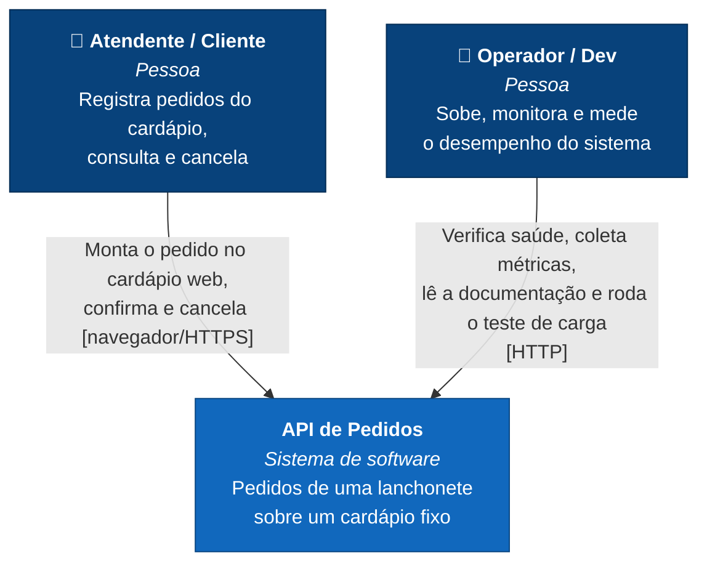
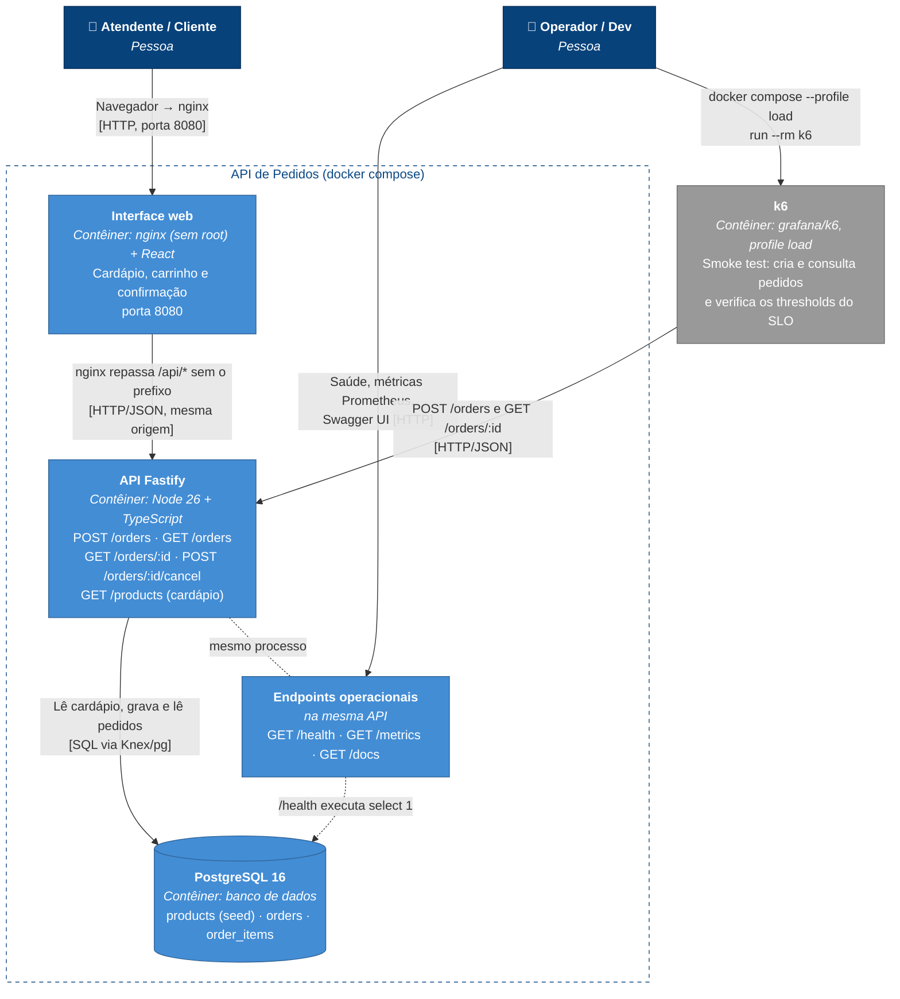

# Arquitetura (modelo C4)

Dois níveis do [modelo C4](https://c4model.com/): Contexto e Contêiner. O nível de Componente segue as camadas descritas no `CLAUDE.md` e na [ADR 0001](../adr/0001-repository-pattern.md): `domain`, `application`, `infra` e `http`.

## Nível 1: Contexto

A API de Pedidos é um sistema único, sem integrações externas. Duas pessoas interagem com ela:

- **Atendente ou cliente:** usa a interface web do cardápio, que monta o carrinho e chama os endpoints de negócio para criar, consultar e cancelar pedidos. O preço sempre vem do cardápio do próprio sistema.
- **Operador/dev:** não usa os pedidos em si. Cuida da operação: verifica a saúde do sistema, coleta métricas, consulta a documentação interativa e mede o desempenho contra o SLO.

## Nível 2: Contêiner

O sistema roda em três contêineres (interface web, API e PostgreSQL), orquestrados pelo `docker-compose.yml`. Uma ação do usuário percorre **navegador → nginx (interface web) → API → PostgreSQL**. A caixa "Endpoints operacionais" não é um contêiner: são rotas do mesmo processo da API.

- **Interface web:** arquivos estáticos do React servidos por nginx sem root. O nginx também repassa `/api/*` para a API, para que o navegador fale sempre com a mesma origem (sem CORS). O total do carrinho é só uma prévia; o valor oficial vem da API.

- **API Fastify:** um processo Node que atende os quatro endpoints de negócio. Os endpoints operacionais rodam no mesmo processo e na mesma porta:
  - `/health` faz um `select 1` para verificar o banco;
  - `/metrics` expõe o histograma de latência no formato Prometheus;
  - `/docs` serve o Swagger UI a partir do `docs/openapi.yaml`.
- **PostgreSQL:** guarda o cardápio (populado por seed a cada inicialização) e os pedidos, com nome e preço congelados nos itens.

O **k6** (em cinza) não faz parte do sistema em produção. É uma ferramenta de medição que só sobe com o profile `load` e gera tráfego contra a API para verificar o SLO de `POST /orders` (ver [desempenho](../desempenho.md)).
